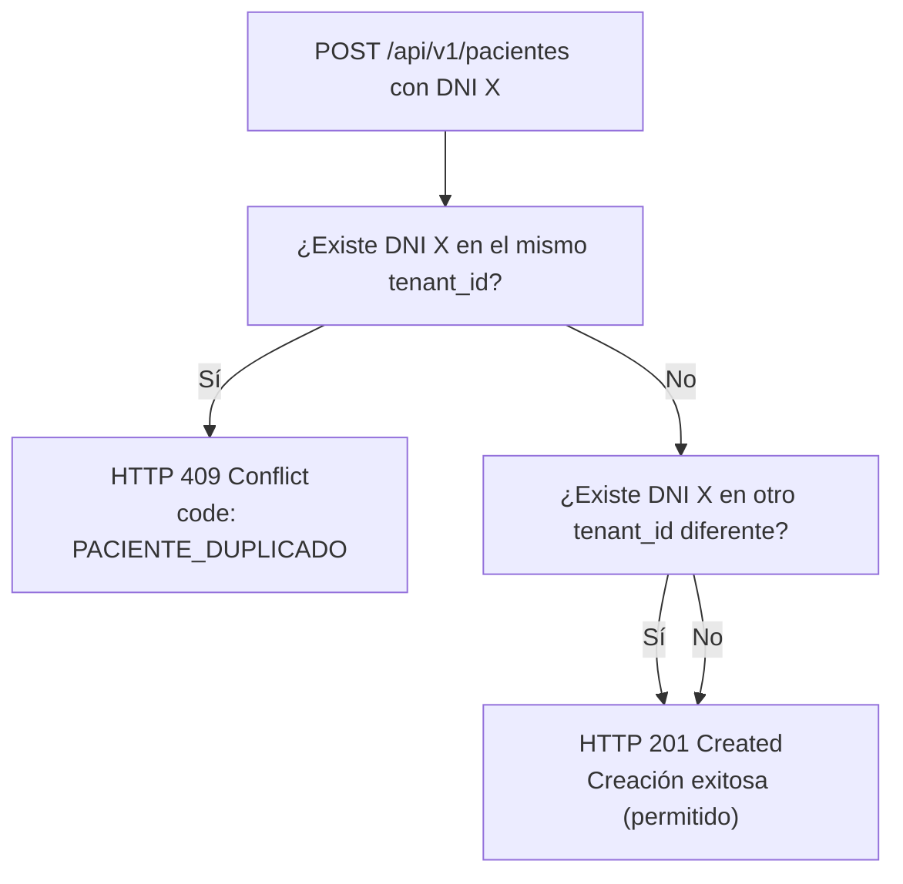

# Generador y Auditor de Datos Sintéticos de Pacientes (`c-07-gestion-pacientes`)

Skill metodológica y técnica para auditar, diseñar y generar fixtures de prueba y suites de verificación para el módulo de pacientes (**Change C-07: `gestion-pacientes`**).

Garantiza que toda prueba automatizada opere con **datos 100% sintéticos y ficticios** (cumpliendo estrictamente con la regla de negocio **RN-06** y la regla dura 3 de privacidad), valide rigurosamente el **contrato de paciente** con su **envelope uniforme de error**, soporte los **casos de borde multi-tenant** (aislamiento vertical y horizontal, unicidad de DNI por tenant) y alcance una **cobertura de código >= 97%** comprobada mediante `pytest`.

---

## Cuándo invocarla

- Al redactar las especificaciones normativas (`proposal.md`, `design.md`, `specs/`) del change `C-07 gestion-pacientes`.
- Al generar o refactorizar fixtures de prueba para pacientes en `backend/tests/test_api_pacientes.py`.
- Al auditar que ninguna prueba o fixture contenga datos personales reales (PII).
- Al verificar la consistencia del contrato de API y los esquemas de validación de pacientes.
- Al ejecutar la suite de pruebas del módulo de pacientes para auditar el criterio de cobertura mínima (>= 97%).
- Antes de emitir el reporte de conformidad o archivar (`/opsx:archive`) el change `C-07`.

---

## Insumos a consultar ANTES de usarla

1. **`knowledge-base/business-rules.md`**:
   - `§RN-05`: Aislamiento multi-tenant (pertenencia estricta a un único tenant).
   - `§RN-06`: Datos sintéticos y privacidad (prohibición terminante de PII real).
2. **`knowledge-base/data-models.md`**:
   - `§2.4`: Modelo conceptual de `Paciente` (`id`, `tenant_id`, `dni`, `nombre`, `telefono`).
   - `§3`: Relaciones (`Tenant` 1 : N `Paciente`).
   - `§5`: Invariantes de persistencia y pertenencia al tenant.
3. **`knowledge-base/features.md`**:
   - `§F-11`: Alta y consulta de pacientes.
   - `§5`: Endpoints proyectados (`POST /api/v1/pacientes`, `GET /api/v1/pacientes`).
4. **`knowledge-base/actors.md`**:
   - `§3`: Matriz de permisos RBAC por rol.
   - `§7`: Permisos sobre la gestión de pacientes (roles autorizados para alta y consulta).
5. **`knowledge-base/decisions.md`**:
   - `D-01`: Multi-tenant obligatorio en toda entidad y consulta.
   - `D-04`: Pruebas contra base de datos SQLite real (sin mocks de persistencia).
   - `D-05`: Sin secretos en el repositorio ni credenciales en código.
6. **Código fuente base**:
   - `backend/src/domain/models.py`: Entidades de dominio.
   - `backend/src/api/esquemas.py`: Esquemas Pydantic y validaciones de entrada/salida.
   - `backend/src/api/errores.py`: Envelope estándar `{"error": {"code": "...", "message": "..."}}`.
   - `backend/src/api/dependencias.py`: Extracción del contexto de usuario y `tenant_id`.

---

## 1. Regla RN-06 y Política de Privacidad Estricta (Regla Dura 3)

El sistema gestiona datos de salud sensibles. La **Regla Dura 3** del proyecto y la regla de negocio **RN-06** establecen que **bajo ninguna circunstancia** deben registrarse o procesarse datos personales reales en el repositorio, pruebas, fixtures, documentación o migraciones.

### 1.1. Criterios de generación de datos sintéticos

Todos los fixtures deben crearse siguiendo patrones determinísticos, verosímiles pero inequívocamente ficticios:

| Campo | Regla de Formato | Patrones Válidos Permitidos | Anti-patrones Prohibidos (Rechazo inmediato) |
|---|---|---|---|
| **`dni`** | Exactamente 8 dígitos numéricos (`^\d{8}$`), sin puntos, guiones ni letras. | `"10000001"`, `"10000002"`, `"20000001"`, `"99000001"` (rangos de prueba o secuencias canónicas). | DNI real de personas, números con puntos (`"10.000.001"`), longitudes != 8 (`"123"`, `"123456789"`), caracteres alfanuméricos. |
| **`nombre`** | Nombre y apellido verosímiles sintéticos o etiquetados explícitamente como ficticios. | `"Paciente Ficticio Uno"`, `"Ana Sintética"`, `"Carlos Gómez Ficticio"`, `"Juan de Prueba"`. | Nombres y apellidos de pacientes reales de clínicas, figuras públicas reales, strings vacíos (`""`), solo espacios (`"   "`). |
| **`telefono`** | Formato de número de teléfono estándar (código de área + número ficticio). | `"+54 11 4000-0001"`, `"+54 9 11 1111-2222"`, `"011-4000-0001"`, `"1140000001"`. | Números de teléfono reales en servicio activo, cadenas no numéricas inválidas (`"telefono123"`), números de emergencia o líneas comerciales reales. |
| **`tenant_id`** | Identificador de clínica sintético (entero positivo o UUID de testing). | `tenant_id = 1`, `tenant_id = 2`, `tenant_id = 99`. | `None`, strings vacíos, referencias a clínicas privadas reales con nombres comerciales sin anonimizar. |

### 1.2. Protocolo de auditoría de privacidad

Antes de dar el visto bueno a cualquier suite de tests de pacientes:
1. Escanear el archivo `backend/tests/test_api_pacientes.py` buscando cadenas que coincidan con teléfonos o números de documento reales.
2. Comprobar que ningún fixture provenga de volcados de bases de datos o scraping.
3. Asegurar que los datos sintéticos cubran tanto caracteres especiales válidos (tildes, eñes en nombres) como longitudes estándar.

---

## 2. Contrato de Paciente y Envelope Uniforme de Error

### 2.1. Modelo de Dominio (`backend/src/domain/models.py`)

La entidad `Paciente` debe mantenerse como una clase pura del dominio, sin acoplamiento a frameworks (FastAPI, Pydantic, SQLAlchemy):

```python
@dataclass(frozen=True)
class Paciente:
    """Entidad de dominio que representa a una persona atendida en una clínica."""

    dni: str
    nombre: str
    telefono: str
    tenant_id: int
    id: int | None = None
```

*Invariante de dominio:* El `tenant_id` es obligatorio para garantizar que ninguna instancia de paciente carezca de clínica asociada.

### 2.2. Esquemas de API (`backend/src/api/esquemas.py`)

Los esquemas Pydantic deben gobernar la validación de entrada y serialización de salida:

```python
from typing import Annotated
from pydantic import BaseModel, ConfigDict, Field, StringConstraints

PATRON_DNI = r"^\d{8}$"
PATRON_TELEFONO = r"^\+?[0-9\s\-\(\)]{7,20}$"

TextoRequerido = Annotated[str, StringConstraints(strip_whitespace=True, min_length=1)]
DniSintetico = Annotated[str, Field(pattern=PATRON_DNI, description="DNI de 8 dígitos numéricos")]
TelefonoSintetico = Annotated[str, Field(pattern=PATRON_TELEFONO, description="Formato de teléfono válido")]

class PacienteCrear(BaseModel):
    """Payload para POST /api/v1/pacientes.
    
    extra="forbid" impide que el cliente envíe tenant_id o id manualmente.
    El tenant se inyecta desde la sesión autenticada.
    """
    model_config = ConfigDict(extra="forbid")

    dni: DniSintetico
    nombre: TextoRequerido
    telefono: TelefonoSintetico

class PacienteRespuesta(BaseModel):
    """Respuesta para endpoints de pacientes."""
    id: int
    tenant_id: int
    dni: str
    nombre: str
    telefono: str

class PacienteFiltro(BaseModel):
    """Parámetros de búsqueda para GET /api/v1/pacientes."""
    dni: str | None = None
    nombre: str | None = None
```

### 2.3. Envelope Uniforme de Errores

Todos los fallos (validación, conflictos de negocio, seguridad) DEBEN responder con la estructura unificada definida en `src/api/errores.py`:

```json
{
  "error": {
    "code": "CODIGO_ERROR",
    "message": "Descripción comprensible y estable del error"
  }
}
```

#### Catálogo de códigos y status HTTP para pacientes:

| Código de Error (`code`) | HTTP Status | Causa | Formato del `message` |
|---|---|---|---|
| `VALIDACION` | **422** | DNI no numérico, DNI != 8 dígitos, nombre vacío, teléfono inválido, o campos adicionales en el body. | Detalle de validación legible (ej: `"body.dni: string does not match regex"`, sin trazas internas). |
| `PACIENTE_DUPLICADO` | **409** | Intento de registrar un paciente con un DNI ya existente en el **mismo** tenant. | `"Ya existe un paciente con el DNI indicado en este centro"` |
| `PACIENTE_NO_ENCONTRADO` | **404** | Consulta de un paciente inexistente o perteneciente a otro tenant. | `"Paciente no encontrado"` |
| `NO_AUTENTICADO` | **401** | Petición sin token Bearer o token expirado/inválido. | `"No autenticado"` o `"Token inválido"` |
| `ACCESO_DENEGADO` | **403** | Usuario autenticado cuyo rol no tiene permisos de lectura/escritura de pacientes. | `"Acceso denegado"` |
| `TENANT_NO_RESUELTO` | **400** | Imposibilidad de determinar el tenant del usuario autenticado. | `"No se pudo resolver el tenant de la petición"` |

---

## 3. Casos Borde Multi-Tenant y Reglas de Persistencia

El sistema es multi-tenant estricto (Regla Dura 8: `Tenant siempre presente`). La persistencia y la lógica de negocio deben garantizar el aislamiento total.

### 3.1. Aislamiento estricto por `tenant_id`
- Toda consulta SQL (`SELECT`, `INSERT`, `UPDATE`, `DELETE`) debe incluir indefectiblemente el filtro `WHERE tenant_id = :tenant_id`.
- Un usuario autenticado en el Tenant 1 que invoque `GET /api/v1/pacientes` **solo** debe recibir los pacientes de su propio tenant.
- Una búsqueda `GET /api/v1/pacientes?dni=10000001` realizada desde el Tenant 1 no debe encontrar al paciente con ese DNI si sólo está registrado en el Tenant 2.

### 3.2. Unicidad de DNI por tenant (Índice Compuesto)
La restricción de unicidad en la base de datos SQLite debe modelarse a nivel compuesto:
```sql
CREATE UNIQUE INDEX idx_pacientes_tenant_dni ON pacientes(tenant_id, dni);
```

#### Comportamiento esperado ante colisiones de DNI:



1. **Mismo DNI en Tenants Distintos (PERMITIDO)**:
   - Tenant 1 (`Clínica Dental Norte`): registra paciente con DNI `"10000001"`, nombre `"Ana Gómez"` -> `201 Created`.
   - Tenant 2 (`Centro Odontológico Sur`): registra paciente con DNI `"10000001"`, nombre `"Ana Gómez"` -> `201 Created`.
   - *Razón:* Clínicas independientes pueden atender legalmente a la misma persona física sin compartir base clínica.
2. **Mismo DNI en el Mismo Tenant (RECHAZADO)**:
   - Tenant 1 registra paciente con DNI `"10000001"` -> `201 Created`.
   - Tenant 1 intenta volver a registrar un paciente con DNI `"10000001"` -> **`409 Conflict`** con envelope `{"error": {"code": "PACIENTE_DUPLICADO", "message": "..."}}`.
   *(Nota: si el validador de API rechaza duplicados pre-persistencia como regla de esquema, se admite 422 con código `VALIDACION` siempre que el envelope sea uniforme).*

---

## 4. Instrucciones Operativas para el Agente

Cuando se active esta skill para auditar o implementar fixtures en `c-07-gestion-pacientes`, el agente debe seguir obligatoriamente este procedimiento secuencial de 4 fases:

### Fase 1: Inspeccionar Modelos y Esquemas
1. Abrir `backend/src/domain/models.py`:
   - Verificar la presencia de la entidad `Paciente`.
   - Comprobar que no importe librerías de infraestructura (`pydantic`, `fastapi`, `sqlite3`).
2. Abrir `backend/src/api/esquemas.py`:
   - Comprobar la existencia de `PacienteCrear`, `PacienteRespuesta`, `PacienteFiltro`.
   - Verificar `extra="forbid"` en `PacienteCrear` y la validación regex `^\d{8}$` en el campo `dni`.
3. Abrir `backend/src/api/errores.py`:
   - Verificar que exista el handler o excepción correspondiente a paciente duplicado y validaciones de datos.

### Fase 2: Auditar o Diseñar la Suite en `backend/tests/test_api_pacientes.py`
El agente debe auditar o implementar la suite en `backend/tests/test_api_pacientes.py` incorporando los fixtures sintéticos canónicos:

```python
import pytest
from fastapi.testclient import TestClient

# Fixture de datos sintéticos válidos (RN-06)
FIXTURE_PACIENTE_A = {
    "dni": "10000001",
    "nombre": "Paciente Ficticio Uno",
    "telefono": "+54 11 4000-0001",
}

FIXTURE_PACIENTE_B = {
    "dni": "10000002",
    "nombre": "Paciente Ficticio Dos",
    "telefono": "+54 11 4000-0002",
}

# Fixture multi-tenant: mismo DNI para pruebas de aislamiento
FIXTURE_PACIENTE_MISMO_DNI = {
    "dni": "20000001",
    "nombre": "Paciente Compartido Sintético",
    "telefono": "+54 11 5000-0001",
}
```

#### Pruebas mínimas obligatorias a incluir:
1. `test_crear_paciente_exitoso`: Registra un paciente sintético válido y devuelve `201` con el ID y los datos normalizados.
2. `test_crear_paciente_dni_duplicado_mismo_tenant_rechazado`: Intenta crear dos veces el mismo DNI bajo el mismo tenant; comprueba respuesta `409` con envelope `{"error": {"code": "PACIENTE_DUPLICADO", ...}}`.
3. `test_crear_paciente_mismo_dni_distinto_tenant_permitido`: Registra el mismo DNI en Tenant 1 y Tenant 2 con respuesta `201` en ambos casos.
4. `test_listar_pacientes_aislamiento_multi_tenant`: Registra pacientes en Tenant 1 y Tenant 2; comprueba que `GET /api/v1/pacientes` con token de Tenant 1 jamás retorne pacientes de Tenant 2.
5. `test_filtrar_pacientes_por_dni_y_nombre`: Búsqueda exacta y parcial dentro del tenant actual.
6. `test_crear_paciente_validacion_fallida_envelope`: Matriz parametrizada con:
   - DNI con letras (`"1000000A"`).
   - DNI con longitud incorrecta (`"123"`, `"123456789"`).
   - Nombre vacío o con puros espacios (`""`, `"   "`).
   - Inyección de campo no permitido en body (`"tenant_id": 1`).
   Todas deben responder `422` con envelope `{"error": {"code": "VALIDACION", ...}}`.
7. `test_seguridad_pacientes_sin_autenticacion`: Peticiones sin token responden `401` (`NO_AUTENTICADO`).
8. `test_seguridad_pacientes_rol_no_autorizado`: Usuarios con roles sin permiso responden `403` (`ACCESO_DENEGADO`).

### Fase 3: Ejecución de Pytest y Verificación de Cobertura (>= 97%)
El agente debe ejecutar la suite de pruebas desde el directorio `backend` utilizando el intérprete y runner del proyecto:

```bash
cd backend && pytest tests/test_api_pacientes.py --cov=src.api.routers.pacientes --cov=src.repositories.pacientes_sqlite --cov=src.domain.models --cov-report=term-missing
```

#### Criterios de aprobación técnica:
- **100% de tests verdes** (Regla Dura 4: Suite verde). Cero fallas, cero errores.
- **Cobertura >= 97%**:
  - La cobertura combinada de sentencias y ramas de los módulos auditados debe ser estrictamente mayor o igual al **97%**.
  - Si la cobertura es menor al 97%, el agente DEBE analizar las líneas no cubiertas en el reporte `term-missing`, agregar los casos de prueba de borde correspondientes y re-ejecutar hasta alcanzar la meta.

### Fase 4: Emisión del Reporte Formal de Auditoría
El agente debe redactar y presentar un reporte formal siguiendo la plantilla provista a continuación. El dictamen debe ser concluyente:
- **`APROBADO`**: Si cumple todos los criterios de sinteticidad, contrato, multi-tenant y cobertura >= 97%.
- **`OBSERVADO`**: Si existe alguna violación de RN-06, fallo de aislamiento, inconsistencia en el envelope de error o cobertura < 97%.

---

## 5. Plantilla de Reporte Formal de Auditoría

```markdown
# Reporte de Auditoría de Datos Sintéticos y Fixtures — Change C-07

**Fecha:** AAAA-MM-DD  
**Auditor / Agente:** [Nombre del Agente / Rol]  
**Módulo auditado:** `C-07 gestion-pacientes` (`backend/tests/test_api_pacientes.py`)  
**Suite ejecutada:** `pytest tests/test_api_pacientes.py`  

### 1. Tabla de Conformidad Normativa

| Dimensión | Criterio / Regla | Estado | Evidencia / Observaciones |
|---|---|---|---|
| **Privacidad (RN-06)** | Datos 100% sintéticos (DNI 8 dígitos ficticio, nombres inventados, teléfono estructurado). Cero PII. | [CUMPLE / NO CUMPLE] | [Detallar fixtures inspeccionados] |
| **Contrato Paciente** | Campos mínimos obligatorios (`dni`, `nombre`, `telefono`, `tenant_id`). `extra="forbid"`. | [CUMPLE / NO CUMPLE] | [Referencia a esquemas Pydantic] |
| **Envelope de Error** | Respuestas unificadas `{"error": {"code": "...", "message": "..."}}` en 400, 401, 403, 404, 409 y 422. | [CUMPLE / NO CUMPLE] | [Códigos verificados en tests] |
| **Aislamiento Multi-Tenant** | Filtro estricto por `tenant_id` en lecturas y mutaciones. Cero fugas cross-tenant. | [CUMPLE / NO CUMPLE] | [Resultado de tests de aislamiento] |
| **Unicidad Multi-Tenant** | DNI único dentro del mismo tenant (rechazo 409/422). Mismo DNI admitido en tenants diferentes. | [CUMPLE / NO CUMPLE] | [Resultado de pruebas de colisión] |
| **Cobertura de Código** | Suite de pruebas 100% verde con cobertura de código >= 97%. | [CUMPLE / NO CUMPLE] | [Porcentaje obtenido: XX.X%] |

### 2. Inventario de Fixtures Sintéticos Verificados

| Identificador Fixture | DNI Sintético | Nombre Sintético | Teléfono Ficticio | Tenant Asignado | Propósito / Caso de Prueba |
|---|---|---|---|---|---|
| `paciente_base_t1` | `10000001` | Paciente Ficticio Uno | +54 11 4000-0001 | 1 | Alta exitosa camino feliz |
| `paciente_duplicado_t1` | `10000001` | Paciente Ficticio Colisión | +54 11 4000-0099 | 1 | Rechazo 409 DNI duplicado |
| `paciente_mismo_dni_t2` | `10000001` | Paciente Ficticio Dos | +54 11 5000-0001 | 2 | Permisión mismo DNI en tenant distinto |
| `paciente_invalido_dni` | `123A` | Paciente Mal Formato | +54 11 4000-0001 | 1 | Rechazo 422 formato de DNI |

### 3. Métricas de Ejecución de Pytest

- **Total de pruebas ejecutadas:** XX
- **Pruebas aprobadas:** XX (100%)
- **Pruebas fallidas:** 0
- **Cobertura total alcanzada:** XX% (Umbral mínimo exigido: 97%)
- **Líneas no cubiertas (Missing):** Ninguna / [Listar si aplica]

### 4. Dictamen Final

**Resultado:** [APROBADO / OBSERVADO]  
**Justificación:** [Síntesis concisa justificando el dictamen según los hallazgos].
```

---

## 6. Checklist de Verificación Rápida para el Agente

Antes de dar por concluida la tarea de auditoría o generación de fixtures, tildar los siguientes 10 puntos:

- [ ] 1. **Cero PII real**: Ningún nombre, DNI o teléfono corresponde a personas o teléfonos reales.
- [ ] 2. **DNI de 8 dígitos**: Todos los fixtures usan DNI con formato estricto `^\d{8}$`.
- [ ] 3. **Contrato de entrada**: `PacienteCrear` rechaza atributos adicionales (`extra="forbid"`).
- [ ] 4. **Tenant protegido**: `tenant_id` no se recibe en el body del endpoint de creación.
- [ ] 5. **Envelope estándar**: Todo error responde con `{"error": {"code": "...", "message": "..."}}`.
- [ ] 6. **Colisión en mismo tenant**: Provoca `409 Conflict` (o 422 de unicidad) con código estable.
- [ ] 7. **Mismo DNI cross-tenant**: Verificado y permitido entre clínicas distintas.
- [ ] 8. **Aislamiento horizontal**: Pruebas demuestran que Tenant A no lista pacientes de Tenant B.
- [ ] 9. **Suite verde**: Pytest pasa al 100% sin advertencias ni mocks sobre la persistencia.
- [ ] 10. **Cobertura >= 97%**: Verificada con `--cov` sobre los módulos de pacientes.
